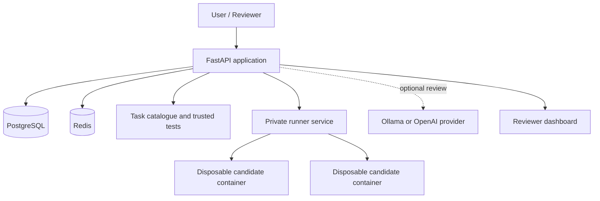

# AI Code Evaluation Lab

**A Python code-evaluation platform with isolated execution, trusted test scoring, and optional AI-assisted code review.**

AI Code Evaluation Lab is a backend engineering project built with FastAPI. It accepts Python submissions, performs static inspection, executes registered tasks in disposable Docker containers, calculates scores using server-controlled tests, and provides authenticated evaluation history and a reviewer workspace.

> **Release:** v1.0.0  
> **Project status:** Locally operated portfolio project. It is not presented as a publicly hosted or production-hardened multi-tenant service.

[](https://www.python.org/)
[](https://fastapi.tiangolo.com/)
[](https://www.postgresql.org/)
[](https://www.docker.com/)
[](LICENSE)

## What it does

A user submits Python source code against a published task. The API validates and inspects the submission, then—when execution is requested—sends it to a private runner. The runner starts a fresh restricted container for each test case. Trusted test expectations stay outside the candidate container, and the API calculates the final score from validated runner results.

AI review is a separate, optional workflow. It provides advisory feedback with source-line evidence; it does not execute generated code or alter trusted test scores.

## Highlights

- **Code submission and inspection:** Python syntax validation and basic static analysis.
- **Trusted evaluation:** Published server-managed tasks and immutable test-suite versions.
- **Isolated execution:** Disposable candidate containers with network access disabled and resource limits.
- **Server-side scoring:** The API validates execution reports and calculates scores from trusted test outcomes.
- **Accounts and history:** Registration, login, short-lived JWT access tokens, and user-scoped evaluation records.
- **AI-assisted review:** Optional local Ollama provider or explicitly configured OpenAI provider.
- **Reviewer workspace:** Assignment-scoped queues, submission inspection, and independent human review decisions.
- **Operational safeguards:** Redis-backed rate limits, health probes, request IDs, structured logs, and optional Prometheus metrics.

## Architecture



The API owns authentication, task definitions, trusted test expectations, persistence, validation, and scoring. The runner executes candidate code and returns results; candidate containers do not receive the full test suite or expected values.

## Technology

| Area | Technologies |
|---|---|
| Language and API | Python 3.11+, FastAPI, Pydantic |
| Persistence | PostgreSQL, SQLAlchemy, Alembic |
| Supporting services | Redis |
| Execution | Docker Engine, Docker SDK, Docker Compose |
| Authentication | JWT, Argon2 password hashing |
| AI review | Ollama (local default), optional OpenAI provider |
| Quality | Pytest, Ruff, GitHub Actions |

## Main workflows

### 1. Submit and evaluate code

1. An authenticated user selects a published task.
2. The API validates the request and performs static inspection.
3. If execution is enabled, the API sends the source and registered test inputs to the private runner.
4. The runner executes each test case in a fresh restricted container.
5. The API validates the report, calculates the score, and stores the evaluation.
6. The user can retrieve their evaluation history and detailed results.

The first registered task is `python.add`, with five fixed test cases. The public task catalogue does not expose expected test values.

### 2. Request an AI review

AI review is explicitly requested and separate from test execution. The review contains a summary, strengths, actionable findings, and next steps. Findings include source line ranges and quoted excerpts that the API checks against the saved submission.

- **Ollama:** The default provider runs locally on the developer's machine.
- **OpenAI:** An optional provider can be configured with an API key. Source code is sent to the provider only when a user explicitly requests a review with that provider selected.

AI feedback is advisory and never changes trusted scores or test outcomes.

### 3. Review submissions

The reviewer workspace is available at `/reviewer`. Administrators can assign and reassign submissions. Reviewers see only evaluations assigned to them; administrators can inspect all evaluations. Human decisions are stored separately from AI reviews and automated test results.

## Local setup

### Requirements

- Python 3.11 or newer
- Docker Engine with Docker Compose v2 for the full execution stack
- Git

### Run the application with Docker Compose

1. Clone the repository and enter the project directory.
2. Create a local environment file from the example:

   ```bash
   cp .env.example .env
   ```

   On Windows PowerShell, use `Copy-Item .env.example .env`.

3. Set independent, strong values for `POSTGRES_PASSWORD`, `JWT_SECRET`, and `RUNNER_TOKEN` in `.env`. Do not commit this file.
4. Start the services:

   ```bash
   docker compose --env-file .env up --build -d
   ```

5. Check service status and API readiness:

   ```bash
   docker compose ps
   ```

   Open [http://127.0.0.1:8000/health/ready](http://127.0.0.1:8000/health/ready).

The API is bound to localhost on port 8000. PostgreSQL data is stored in the named `postgres_data` Docker volume. The API applies Alembic migrations during startup. The runner is not published to the host and is reachable through the private Compose network.

> **Data safety:** `docker compose down -v` deletes the PostgreSQL volume and saved evaluation history. Do not use it unless you intentionally want to erase that data.

### Optional AI review with Ollama

The default review provider is local Ollama. Install Ollama on the host, download the configured model, and ensure the API container can reach the host Ollama service. The default model is `qwen3.5:4b`.

Relevant environment settings:

```dotenv
AI_REVIEW_PROVIDER=ollama
OLLAMA_BASE_URL=http://host.docker.internal:11434
OLLAMA_REVIEW_MODEL=qwen3.5:4b
```

Ollama's API has no built-in authentication. Keep it restricted to trusted local access; do not expose it to the public internet or untrusted networks.

An OpenAI provider is also available by setting `AI_REVIEW_PROVIDER=openai`, `OPENAI_API_KEY`, and optionally `OPENAI_REVIEW_MODEL`. API usage is billed separately from a ChatGPT subscription. Keep credentials in `.env` or a secret manager.

## Reviewer access

Register an account through the API, then grant reviewer access from the API container:

```bash
docker compose exec api python -m app.promote_reviewer reviewer@example.com
```

Revoke reviewer access:

```bash
docker compose exec api python -m app.promote_reviewer --revoke reviewer@example.com
```

New accounts are not automatically reviewers or administrators. Administrator promotion is a separate, explicit operation.

## API overview

| Endpoint | Purpose | Access |
|---|---|---|
| `GET /health/live` | Process liveness | Public |
| `GET /health/ready` | Database and Redis readiness | Public |
| `GET /api/v1/tasks` | List published tasks | Public |
| `GET /api/v1/tasks/{task_id}` | Published task details | Public |
| `POST /api/v1/auth/register` | Register an account | Public, rate limited |
| `POST /api/v1/auth/login` | Obtain access token | Public, rate limited |
| `GET /api/v1/auth/me` | Current account | Authenticated |
| `POST /api/v1/evaluations` | Submit an evaluation | Authenticated |
| `GET /api/v1/evaluations` | List own evaluations | Authenticated |
| `GET /api/v1/evaluations/{id}` | Retrieve own evaluation | Authenticated |
| `POST /api/v1/evaluations/{id}/review` | Request AI review | Authenticated |
| `GET /api/v1/evaluations/{id}/review` | Retrieve saved AI review | Authenticated |
| `GET /reviewer` | Reviewer workspace | Role protected |
| `GET /api/v1/reviewer/evaluations` | Reviewer queue | Reviewer / administrator |

Interactive API documentation is available at [http://127.0.0.1:8000/docs](http://127.0.0.1:8000/docs) while the local API is running.

## Security model and limitations

Candidate containers are configured with multiple restrictions:

- Network disabled and read-only root filesystem
- Non-root candidate UID/GID
- Linux capabilities dropped and `no-new-privileges`
- Memory, CPU, process, timeout, and file-size limits
- Bounded stdout/stderr capture
- Fresh container per test case and automatic cleanup

These controls reduce risk; they do **not** establish a perfect or production-grade security boundary. Containers share the host kernel. The runner service currently has access to the Docker daemon socket, which carries effectively host-level authority. Keep the service private, protect its bearer token, keep the host and Docker patched, and do not expose the runner endpoint publicly.

This project is intended for local operation and portfolio demonstration. Before accepting arbitrary public or multi-tenant submissions, it would need a stronger isolation boundary (for example, disposable VMs or a purpose-built sandbox runtime), host-level monitoring and quotas, and an independent security assessment.

Authentication currently includes registration, login, Argon2 password hashing, short-lived JWT access tokens, per-user record ownership, and Redis-backed rate limits. Email verification, password reset, refresh tokens, token revocation/logout, and account deletion are not implemented. A stolen access token remains valid until it expires.

## Development and quality checks

Install the project and development dependencies in a virtual environment:

```bash
python -m pip install -e ".[dev,runner]"
```

Run migrations and checks:

```bash
alembic upgrade head
python -m pytest
python -m ruff check .
```

GitHub Actions runs the project's automated quality checks.

## Project status

**v1.0.0 — released.** The core evaluation, reviewer, and AI-assisted review workflows are implemented. Further security and operational improvements are future work; see the repository issues and release history for current planning.

## License

This project is licensed under the MIT License. See [LICENSE](LICENSE).
